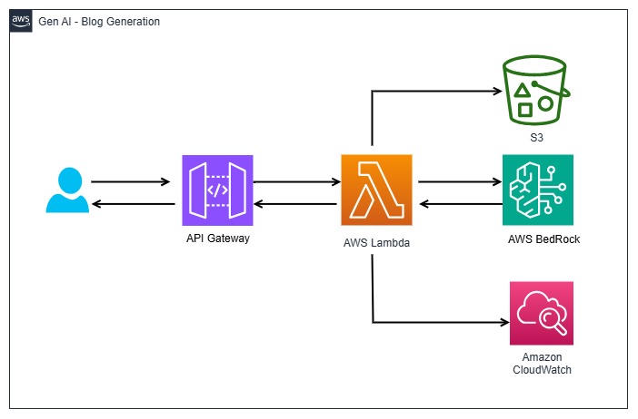

# GenAI Blog Generation — Serverless AI on AWS

A serverless API that generates a blog post on any topic using **Amazon Bedrock (Nova Micro)**, and archives every generated post to **S3**.

Send a topic over HTTP, get back a 200-word blog, and find a timestamped copy waiting in your bucket.

> Built as a hands-on learning project to understand how managed GenAI models plug into a real serverless architecture — API Gateway → Lambda → Bedrock → S3, with CloudWatch for observability and IAM tying it together.

---

## Architecture



**Request flow**

1. Client sends `POST /genai_blog_api` with a JSON body `{ "blogtopic": "..." }`
2. **API Gateway** (HTTP API) routes the request to the Lambda integration
3. **Lambda** validates the input and builds a Bedrock prompt
4. **Bedrock** runs `amazon.nova-micro-v1:0` and returns the generated text
5. **Lambda** writes the result to `s3://genai-blog-generation/blog_outputs/<timestamp>.txt`
6. The blog text is returned to the client; logs land in **CloudWatch**

---

## Services Used

| Service | What it is (one-liner) | Role in this project |
|---|---|---|
| **Amazon Bedrock** | Fully managed access to foundation models from multiple providers through a single API — no servers, no model hosting. | Runs `amazon.nova-micro-v1:0` to generate the blog text. |
| **AWS Lambda** | Run code without provisioning servers; billed only for execution time. | Hosts `lambda_handler` — the orchestration between API Gateway, Bedrock and S3. |
| **Lambda Layer** | A reusable `.zip` of libraries mounted into the function, kept separate from your code. | Ships a current `boto3`/`botocore` so the Bedrock Nova APIs are available. |
| **Amazon API Gateway** | A fully managed front door that exposes your backend as an HTTP endpoint. | Public `POST` route that triggers the Lambda. |
| **Amazon S3** | Object storage for any amount of data, at any time, from anywhere. | Durable archive of every generated blog post. |
| **Amazon CloudWatch** | Monitoring and logging for AWS resources and applications. | Captures Lambda logs, the raw Bedrock response, and errors. |
| **AWS IAM** | Controls who can do what on which AWS resource. | Execution role granting Lambda access to Bedrock, S3 and CloudWatch Logs. |

---

## Use Cases

This pattern — a managed LLM behind a serverless API — generalises to:

- **Content generation** — blogs, product descriptions, marketing copy, social posts
- **Text summarisation** — condensing documents, support tickets, meeting notes
- **Chatbots & virtual assistants** — Q&A over a prompt or a knowledge base
- **Code generation** — scaffolding, boilerplate, code explanation
- **Data extraction & classification** — pulling structured fields out of free text

---

## Repository Structure

```
genai-blog-generation/
├── app.py              # Lambda handler + Bedrock invocation + S3 upload
├── requirements.txt    # boto3, botocore (packaged as a Lambda layer)
├── artifacts/          # Console screenshots + a sample generated blog
└── README.md
```

---

## How It Was Built

### 1. S3 bucket

Created bucket `genai-blog-generation` in `us-east-1`. Generated posts are written under the `blog_outputs/` prefix with a timestamped key, so every run is preserved rather than overwritten.

### 2. IAM role

Created an execution role for the Lambda with permissions for:

- `bedrock:InvokeModel` — to call the Nova model
- `s3:PutObject` — to write to the output bucket
- `logs:CreateLogGroup`, `logs:CreateLogStream`, `logs:PutLogEvents` — CloudWatch logging

> Also required: enabling **model access** for Amazon Nova in the Bedrock console for `us-east-1`. Without it, `InvokeModel` fails with `AccessDeniedException` even when the IAM policy is correct.

### 3. Lambda function + layer

Deployed `app.py` as a Python Lambda. Because the Bedrock Nova APIs need a recent `boto3`, the dependencies were packaged as a **Lambda layer** rather than relying on the runtime's bundled SDK:

```bash
pip install -r requirements.txt -t python/
zip -r lambda_library.zip python/
# upload lambda_library.zip as a layer, then attach it to the function
```

The function timeout was raised above the default 3s — model inference regularly takes longer.

### 4. API Gateway

Created an **HTTP API** (`genai-blog-api`) with:

- **Route** — `POST /genai_blog_api`
- **Integration** — Lambda proxy integration to the function
- **Stage** — `dev`, deployed with an invoke URL

---

## API Usage

**Request**

```bash
curl -X POST https://<api-id>.execute-api.us-east-1.amazonaws.com/dev/genai_blog_api \
  -H "Content-Type: application/json" \
  -d '{"blogtopic": "What is AWS Bedrock"}'
```

**Response** — `200 OK`

```json
"**What is AWS Bedrock in 200 Words**\n\nAWS Bedrock is a service provided by Amazon Web Services..."
```

A copy is simultaneously written to `s3://genai-blog-generation/blog_outputs/20261021_195712.txt`.

**Error responses**

| Status | Condition |
|---|---|
| `400` | Missing or malformed JSON body |
| `400` | `blogtopic` not supplied |
| `500` | Bedrock invocation failed — nothing is written to S3 |

---

## Screenshots

| | |
|---|---|
| [API Gateway — route](artifacts/api_gateway_route.png) | [API Gateway — integration](artifacts/api_gateway_integration.png) |
| [API Gateway — stage](artifacts/api_gateway_stage.png) | [Lambda function](artifacts/lambda.png) |
| [Lambda layer](artifacts/lambda_layer.png) | [IAM role](artifacts/iam.png) |
| [S3 output bucket](artifacts/s3.png) | [CloudWatch logs](artifacts/cloudwatch_log.png) |
| [Postman request](artifacts/postman.png) | [Sample generated blog](artifacts/20261021_195712.txt) |

---

## Notes & Learnings

- **Each Bedrock model family has its own request/response shape.** Nova expects a `messages` payload with `inferenceConfig` and returns text at `output.message.content[0].text`; Llama models use `prompt` and return `generation`. Mixing the two is the quickest route to a `ValidationException`. Using `client.converse()` instead of `invoke_model()` normalises this across model families and makes swapping models a one-line change.
- **Don't return an error string from a function whose result you then truthiness-check.** An early version returned `"Error occurred..."` on failure — a truthy value, so failures were uploaded to S3 and returned as `200 OK`. Returning `None` makes the failure path actually reachable.
- **`max_tokens` has to match the ask.** 200 words is roughly 260–300 tokens; a limit of 50 silently truncates mid-sentence.
- **Keep S3 keys URL-safe.** `%Y-%m-%d %H:%M:%S` produces spaces and colons that need encoding everywhere downstream; `%Y%m%d_%H%M%S` doesn't.
- **The layer exists for a reason.** The Lambda runtime's bundled `boto3` can lag behind the SDK release that adds support for new Bedrock models.

### Security note

The route in this project is deployed **without an authorizer** — fine for a learning sandbox, not for anything left running. Before sharing an endpoint publicly, attach an API key, a Lambda authorizer, or IAM auth, and set throttling limits on the stage. Every unauthenticated call is a billable Bedrock invocation.

---

## Possible Extensions

- Stream responses with `invoke_model_with_response_stream` for faster perceived latency
- Add DynamoDB to index generated posts by topic and timestamp
- Support tone and length parameters in the request body
- Infrastructure as code (SAM / Terraform / CDK) to replace the console clicks
- Return a presigned S3 URL alongside the blog text

---

## Credits

Learned and built by following [**Krish Naik**](https://www.youtube.com/@krishnaik06)'s walkthrough on YouTube: **https://youtu.be/3OP39y4dO_Y**

Highly recommended if you want to build this yourself.

---

## Tech Stack

`Python 3` · `boto3` · `AWS Lambda` · `Amazon Bedrock (Nova Micro)` · `API Gateway` · `S3` · `CloudWatch` · `IAM`
